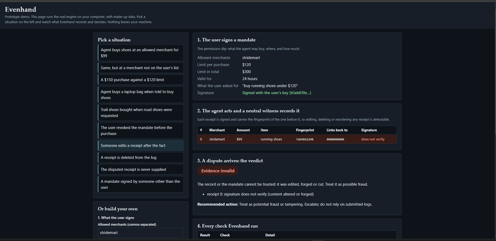

# Evenhand

A neutral witness for AI agents that spend money.

> **Status: v0.2 prototype. Not production software. Tested only on synthetic data.**



## The problem

When an AI agent buys something or acts on an account and the outcome is disputed, nobody can prove what the user actually allowed. The record is often signed by the agent itself. Merchants absorb the loss by default, banks restrict outside agents, and payment networks cover cards only and have not said who pays when an agent overreaches.

## What Evenhand does

Evenhand records what an agent actually did from outside the agent's control (a **witness**), checks it against the user's signed authority (a **mandate**), and returns a **verdict** with an **evidence packet** that a merchant, bank or insurer can act on.

```
User signs MANDATE -> Agent acts -> WITNESS signs hash-chained RECEIPTS
Dispute opened -> ADJUDICATOR checks signatures, log integrity, limits, intent -> VERDICT + EVIDENCE PACKET
```

## Quickstart

Python 3.10 or newer. The test suite passes on Python 3.15.

```bash
python -m pip install -e .
python examples/quickstart.py   # signs a mandate, records two purchases, rejects a tampered receipt
python examples/witness_in_30_minutes.py   # the 30-minute integration, end to end
python examples/web_demo.py     # browser demo: click through situations
python -m unittest discover -s tests
```

The quickstart signs a mandate, records two agent purchases, issues verdicts, shows a tampered receipt being rejected, and prints an evidence packet.

### Witness your agent in 30 minutes

```python
from evenhand import Gateway, quick_mandate
signed, principal = quick_mandate(intent="buy running shoes under $120", merchants=["stridemart"], max_per_txn=120)
gw = Gateway(signed, expected_principal_pub=principal.public_hex)

@gw.tool                      # every successful call is signed and chained
def buy(merchant, amount, description): ...
```

Full walkthrough: [docs/QUICKSTART.md](docs/QUICKSTART.md).

## Verdicts

`within_mandate`, `exceeded_mandate`, `ambiguous_intent` (goes to a human), `evidence_insufficient`, `evidence_invalid` (tampered, forged or unverifiable).

## Design principles

1. **Evidence, not opinion.** Every verdict lists the checks behind it.
2. **The witness sits outside the agent's trust boundary.**
3. **The verifier is open and runs offline.** Pin the user's and the witness's public keys and you do not have to trust us. See [docs/TRUST-MODEL.md](docs/TRUST-MODEL.md).
4. **Interoperate with open standards** (Verifiable Intent and AP2, now under the FIDO Alliance) instead of inventing a new mandate format. Adapters are planned and **not yet built**. See [docs/STANDARDS.md](docs/STANDARDS.md).
5. **No custody of funds, no consumer scoring, humans decide adverse consumer outcomes.** See [docs/NEUTRALITY.md](docs/NEUTRALITY.md).

## What is in this repository

- `evenhand/`: the library (mandates, witness receipts, adjudicator, evidence packets, a synthetic dispute simulator).
- `evenhand/server.py`, `evenhand/store.py`, `evenhand/checkpoint.py`: an HTTP API with saved receipts, a stable witness key and signed checkpoints. See [docs/HTTP-API.md](docs/HTTP-API.md).
- `evenhand/mcp/`: an MCP witness proxy (stdio and HTTP) that wraps an MCP tool server so every purchase an agent makes is witnessed. See [docs/MCP-PROXY.md](docs/MCP-PROXY.md).
- `clients/typescript/`: a TypeScript client and offline verifier, tested against the Python witness.
- `examples/quickstart.py`: a runnable walkthrough.
- `docs/SPEC.md`: the evidence format as implemented. `docs/NEUTRALITY.md`: the neutrality charter. `docs/BENCHMARK.md`: the synthetic benchmark. `docs/TRUST-MODEL.md`: how to verify a record without trusting us. `docs/STANDARDS.md`: how Evenhand relates to Verifiable Intent and AP2.
- `tests/`: unit tests for the signing, chain, persistence, checkpoint, adjudication and MCP proxy logic.

## Limitations, stated plainly

- **The benchmark is synthetic.** Its ground truth comes from the generator in this repository, so scenarios that depend only on hard limits score 100% by construction. The informative result is where simple text matching fails (look-alike purchases, vague intents). It says nothing about real-world accuracy.
- Intent matching is a heuristic baseline; the model-based matcher is a stub.
- The mandate format is a simplified internal one. Verifiable Intent and AP2 adapters are planned.
- The witness runs as a library, an HTTP server or an MCP proxy that you run yourself. No hosted witness exists, and checkpoints are signed but not yet published anywhere independent. Truncation of the end of a chain can only be detected against a checkpoint you hold.
- Not audited. Do not use it for real money or real customer data.

## Roadmap

Verifiable Intent and AP2 adapters, a hosted witness that publishes checkpoints independently, non-card actions (ACH, wallets), and a human-review queue.

## Development and license

Parts of this code were drafted with AI assistance (Claude) under the maintainer's direction and are covered by tests. Contributions are welcome: see [CONTRIBUTING.md](CONTRIBUTING.md). Report security issues as described in [SECURITY.md](SECURITY.md).

Licensed under the Apache License 2.0. See [LICENSE](LICENSE).